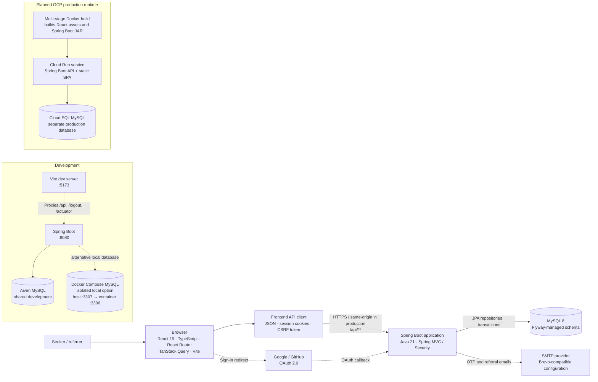
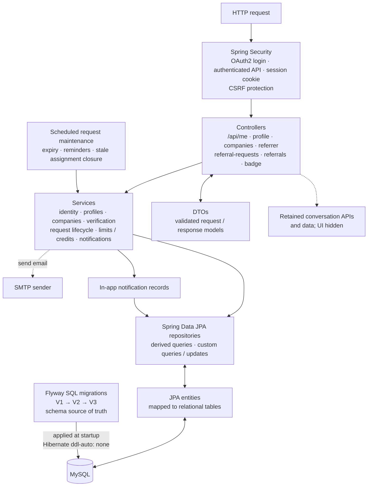
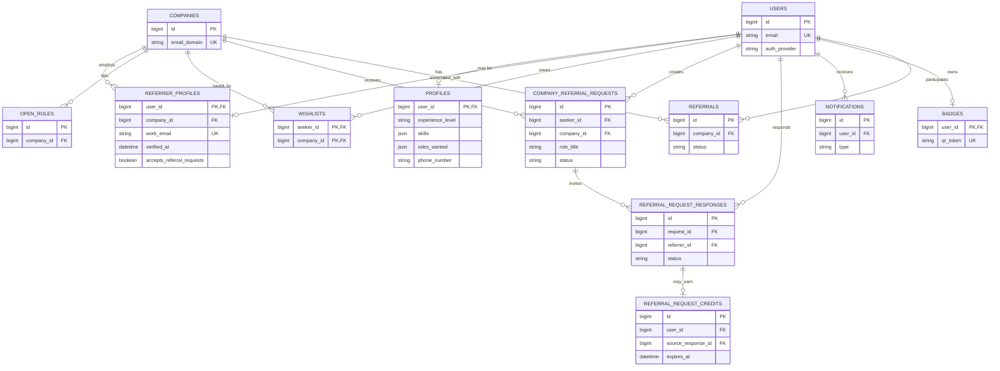

# Referral Portal architecture

This diagram describes the application as it exists in this repository. Solid flows are
implemented; dashed flows are optional integrations or retained capabilities. The
referral-request workflow is the primary user journey.

## System context and runtime



In development, Vite serves the frontend separately and proxies API calls to Spring Boot.
The backend normally connects to the shared Aiven development database; Docker Compose
MySQL is an isolated local alternative. The planned GCP production deployment uses Cloud
Run for the packaged app and Cloud SQL for a database isolated from development. The
production Dockerfile builds the frontend into Spring Boot's static resources so one
application serves both the SPA and API. Database URLs and
credentials, OAuth client credentials, and SMTP settings are environment configuration,
not source-controlled values.

## Backend structure



API controllers delegate business rules to services. Services persist through Spring Data
JPA repositories, which map entities to the Flyway-managed MySQL schema. DTOs are the
HTTP boundary; entities are persistence models. The scheduled worker runs inside the
backend process and applies referral-request lifecycle rules.

## Active referral workflow

```mermaid
sequenceDiagram
    actor Seeker
    participant UI as React app
    participant API as Spring Boot API
    participant DB as MySQL
    participant Referrer
    participant Mail as SMTP

    Seeker->>UI: Sign in with Google or GitHub
    UI->>API: OAuth authorization and callback
    API->>DB: Find or create user and badge
    API-->>UI: Authenticated session cookie
    UI->>API: GET /api/me and profile
    Seeker->>UI: Complete profile; browse companies
    UI->>API: GET /api/companies
    API->>DB: Find companies with verified, opted-in referrers
    Seeker->>UI: Submit company + role + sharing choices
    UI->>API: POST /api/referral-requests
    API->>DB: Validate eligibility / allowance; save request and invite responses
    API->>DB: Save in-app notifications
    API-->>Mail: Invite opted-in employees by email
    Referrer->>UI: Accept or decline; choose contact-sharing
    UI->>API: POST /api/referral-requests/{id}/accept
    API->>DB: Save response and acceptance
    Referrer->>UI: Mark referral submitted through employer process
    UI->>API: POST /api/referral-requests/{id}/submitted
    API->>DB: Save submission and referral record
    Seeker->>UI: Confirm submission
    UI->>API: POST /api/referral-requests/{id}/responses/{responseId}/confirm
    API->>DB: Confirm and award eligible request credit
```

Each referral request is for one company and role; it creates a response for each eligible
opted-in employee. Referral acceptance and submission are tracked in the portal, but the
portal does not submit a candidate to the employer's hiring system. Request allowance,
opt-in, work-email verification, assignment capacity, and per-request contact-sharing
consent are enforced by backend services.

## Data domains



Other retained or reserved schema areas include `email_otps` for work-email verification;
`conversations` and `messages` for the hidden legacy chat flow; and `reviews`, `scans`,
`resume_files`, `reports_blocks`, and `credit_ledger` for capabilities that are not fully
implemented in the current UI.

## Cross-cutting behavior

- **Authentication:** Google/GitHub OAuth creates an application session. API routes
  require authentication; mutations use the CSRF token cookie/header pair.
- **Work-email verification:** an employee verifies a work email by OTP before opting in
  as a referrer. Verification and referral-request opt-in are separate actions.
- **Notifications:** referral invitations and lifecycle events are persisted as in-app
  notifications; configured SMTP is used for invitations, reminders, and verification.
- **Automation:** the backend periodically expires unanswered requests, refunds eligible
  allowance, sends reminders, and closes stale accepted assignments.
- **Operations:** Flyway applies schema changes on startup; `/actuator/health` is exposed
  for health checks. GitHub Actions runs backend tests and frontend build checks.
- **Current boundaries:** chat UI is hidden; resume upload, QR scan history, admin tools,
  and employer-system referral submission are not implemented.

