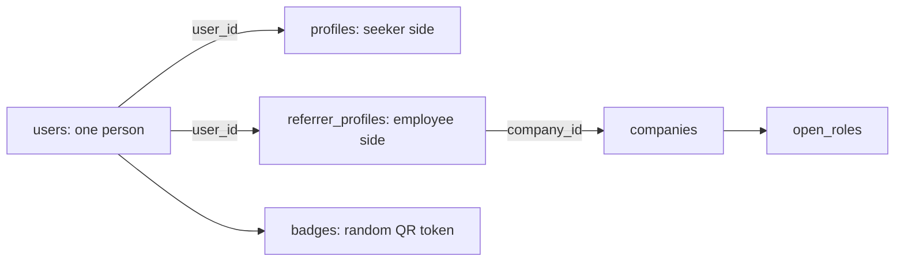

# Referral Portal POC

**Project:** Referral Portal for DevFest Pune  
**Event date:** 13 December 2026  
**Document date:** 9 October 2026  
**Purpose:** Explain the proof of concept (POC), what a user can try, how its data is stored, and what still belongs to the larger product.

> **Status key**  
> **IN POC** = implemented in the current source and suitable to demonstrate, subject to the deployed commit.  
> **PARTIAL** = only part of the workflow is implemented.  
> **NOT IN POC** = planned for the full product, but not implemented in this POC.  
> **BRANCH ONLY** = code exists on a feature branch but is not necessarily in the live deployment.

The live Render service deploys a Git branch. A feature branch is not live just because it was pushed. Confirm the deployed commit in Render before promising a feature in a demo.

## 1. The idea

Referral Portal is a mobile-first event app that helps attendees and employees turn short, in-person conversations into tracked job referrals.

- A **seeker** creates a profile, browses companies, saves companies, and requests a conversation.
- A **referrer** verifies a work email, can choose to be open to meet, and may refer a candidate.
- A **conversation** starts as a meeting request. Chat is available after acceptance.
- A **referral** is a tracked handoff. The portal does not submit a candidate to a company's hiring system.

The POC demonstrates part of this loop. It is not a job board, recruitment platform, or completed event-day system.

## 2. What can be demonstrated

| Capability | POC status | Notes |
|---|---|---|
| Google and GitHub sign-in | IN POC | OAuth creates a user the first time; later sign-ins reuse the account by email. |
| Seeker profile | IN POC | Experience, skills, roles wanted, pitch, and profile links. Resume upload is not included. |
| Work-email verification | IN POC | Six-digit emailed code; unlocks referrer settings. It is not required to sign in or save a seeker profile. |
| Company directory | IN POC | Seeded/sample companies, roles, and verified employees who are open to meet. |
| Wishlist | IN POC | A seeker can save up to five companies. |
| Meeting requests | IN POC | Request, accept, and decline are implemented. Demo referrers can auto-accept. |
| Chat | IN POC | Requires acceptance and is limited to 20 total messages per conversation. |
| QR badge | IN POC | Contains a random token, not the user's database ID. |
| Referrals received | PARTIAL | The app can show received/seeded referral rows. Creating and managing a real referral is not complete. |
| Account deletion | IN POC | Deletes a user's account and associated data after an explicit confirmation. It is permanent. |
| Profile save without work email | BRANCH ONLY | The fix is on `bug/user-can-create-profile-without-work-email-fix`; confirm it has been merged and deployed before demoing. |
| Database Explorer learning page | LOCAL ONLY | `frontend/public/database-explorer.html` is a local, untracked learning aid, not part of the current GitHub deployment. |

## 3. What's not in this POC

These are features for the larger product, not things a tester should assume are available:

- Camera-based QR scanning, scan history, and offline scan synchronization.
- Candidate search/cards and the referrer's Save, Pass, and Refer actions.
- Referrals-made dashboard, status updates, and copying a referral packet.
- Resume upload and private download.
- Enforcement of the hide-from-my-company privacy option in search and scans.
- Creating reports or blocks in the user interface. Existing block records are checked in conversation rules.
- In-app notification workflow and referral notification emails. Brevo is used for verification-code email; the remaining email flows are not complete.
- Automated message-retention/purge job.
- Admin console, sponsor dashboard, live event statistics, and bulk badge export.
- PWA installation/offline support, full 1,000-person load testing, and end-to-end phone testing for all 14 planned screens.
- Credit earning and spending. The ledger is read when calculating budget, but no credit events are currently created.

## 4. How the application is organized

This is one Git repository with two applications:

| Part | Technology | Responsibility |
|---|---|---|
| Frontend | React, TypeScript, Vite | Screens and browser interactions. During development it runs on port 5173. |
| Backend | Java 21, Spring Boot, Maven | OAuth, API endpoints, authorization, business rules, email, and database access. During development it runs on port 8080. |
| Database | MySQL 8 | Stores accounts, profiles, companies, requests, chats, and other records. |
| Schema changes | Flyway SQL migrations | Creates and updates tables when the backend starts. |
| Local database | Docker Compose | Runs MySQL locally on port 3307, separate from an installed MySQL service. |
| Hosted database | Aiven MySQL | Database used by the hosted POC, configured separately from the application container. |
| Hosted app | Render Docker Web Service | Builds and runs the combined React + Spring Boot image. |

The backend uses an explicit **controller → service → repository** layout, with dedicated `dto` and `entity` packages alongside it:

1. **Controller** (`controller/`) receives an HTTP request and returns a response.
2. **Service** (`service/`) applies the product rules, such as request limits or OTP expiry.
3. **Repository** (`repository/`) runs SQL against MySQL.
4. **DTO** (`dto/`) — Java records used to carry data to and from API requests, all consolidated in one package.
5. **Entity** (`entity/`) — JPA `@Entity` classes (one per table) that document the schema and its foreign-key relationships with annotations such as `@OneToOne`, `@ManyToOne`, `@OneToMany`, and `@JoinColumn`.

The database schema is still managed with SQL migrations (Flyway), and repositories still use `JdbcClient` for all real reads/writes — the JPA entities are an additive, documentation-style model layer and are not wired into live queries. All beans across controllers, services, repositories, and the demo seeder use `@Autowired` field injection rather than constructor injection.

## 5. The people and account model

The `users` table is the identity anchor: one row per person. A person can be both a seeker and a referrer without creating a second account.

- `users` stores the sign-in identity, name, email, provider, consent time, and creation time.
- `profiles` stores the seeker's experience, skills, pitch, and links. Its `user_id` points to `users.id`.
- `referrer_profiles` stores the employee side: verified work email, company, job title, availability, slots, and referral limit.
- `badges` stores one random QR token per user.

Sign-in email and work email are different concepts. The login email belongs to `users`; the verified company email belongs to `referrer_profiles` after OTP confirmation.

## 6. Main user flows and their tables

### A. Sign in

1. The user chooses Google or GitHub.
2. The backend looks for their normalized email in `users`.
3. If it is new, the backend inserts `users` and a corresponding `badges` row in one transaction.
4. If the email already exists, the app reuses that account.
5. The app checks whether a `profiles` row exists and routes the user to Profile or Companies.

**Tables:** `users`, `badges`, then `profiles` when checking onboarding. Optional demo data may add conversations/referrals for new accounts.

### B. Create a seeker profile

The user can save their profile without a work email. The backend inserts or updates their row in `profiles`, keyed by `user_id`.

**Table:** `profiles`. Skills and roles wanted are JSON lists. Work-email verification is a separate optional step to unlock referrer settings.

### C. Verify a work email

1. The user enters a company email address.
2. The app rejects common free-email domains, addresses already claimed by another account, and excessive resend attempts.
3. The backend creates a random six-digit code and stores only its BCrypt hash in `email_otps`.
4. Brevo sends the code. It expires after 10 minutes; incorrect attempts are counted and locked after five.
5. On correct confirmation, the backend finds or creates a `companies` row from the email domain and creates/updates `referrer_profiles`.

**Tables:** `users`, `email_otps`, `companies`, `referrer_profiles`. The company name is derived from the domain; organizers can rename/manage company details later.

### D. Browse and save companies

The company directory reads `companies` and its `open_roles`. The employees shown beneath a company come from `referrer_profiles` joined to `users`, filtered to verified employees who are open to meet. A seeker saving a company creates a row in `wishlists`.

The wishlist's composite key (`seeker_id`, `company_id`) prevents duplicate saves. The five-company maximum is enforced by application code.

**Tables:** `companies`, `open_roles`, `referrer_profiles`, `users`, `wishlists`.

### E. Request a meeting and chat

1. A seeker requests a meeting with an available verified referrer.
2. The backend checks that the target is not the seeker, is not their own company, is not blocked, has capacity, and the seeker has request budget.
3. A `conversations` row is created with `status = pending`.
4. The recipient accepts or declines. A decline is silent to the seeker.
5. After acceptance, messages are stored in `messages`.
6. A transaction first increments `conversations.message_count` only if it is under 20, then inserts the message. The limit is shared by both participants.

**Tables:** `conversations`, `messages`, `reports_blocks`, `credit_ledger`, plus `users`, `companies`, and `referrer_profiles` during checks.

### F. Referral handoff

The full product will create a `referrals` row when an employee refers a candidate, then track its status. In this POC the received-referrals screen is partial/read-only; do not treat it as a complete referral workflow.

**Tables designed for this workflow:** `referrals`, `users`, `companies`, `open_roles`. `reviews` is reserved for private Save/Pass notes.

### G. Delete an account

The user confirms by typing `DELETE`. Deletion is permanent and runs in a transaction. The repository first deletes conversations, reviews, and referrals because their foreign keys do not cascade. It then deletes the `users` row; configured cascade rules remove the user's profile, badge, work-email OTPs, wishlist rows, scans, and other owned data. The company row is not deleted because it may be shared by other employees.

## 7. Database table guide

The schema has **17 tables**, grouped by what they represent:

| Table | Plain-language purpose | POC status |
|---|---|---|
| `users` | Sign-in identity; one row per person | IN POC |
| `profiles` | Seeker profile | IN POC |
| `referrer_profiles` | Verified employee/referrer settings | IN POC |
| `companies` | Company directory | IN POC |
| `open_roles` | Company roles shown in the directory | IN POC; mainly seeded |
| `email_otps` | Hashed, expiring work-email verification codes | IN POC |
| `badges` | Random QR token for each person | IN POC |
| `wishlists` | Seeker-to-company saved-interest links | IN POC |
| `conversations` | Meeting request and chat lifecycle/counter | IN POC |
| `messages` | Chat text | IN POC |
| `referrals` | Referral handoff and status history | PARTIAL/read-only display |
| `reviews` | Referrer Save/Pass and private notes | NOT IN POC |
| `scans` | QR scan history | NOT IN POC |
| `reports_blocks` | Report/block records | PARTIAL; existing blocks are checked |
| `credit_ledger` | Request credits | PARTIAL; currently contributes zero |
| `notifications` | In-app event notifications | NOT IN POC |
| `resume_files` | Private resume file data | NOT IN POC |

## 8. Demo data and test status

- Demo mode seeds one fictional "Demo Company" with five demo referrer users (Asha, Rohan, Meera, Sneha, Karan) so the directory is populated. Demo referrers may auto-accept requests to make the chat flow easy to try.
- Demo data is not real hiring activity and must be turned off for a real event launch.
- Backend tests cover Spring startup, work-email verification rules, and account deletion. The frontend has a production build check.
- CI checks the backend and frontend builds when changes are pushed to GitHub.
- A passing test/build is not a substitute for testing sign-in and email delivery on the actual hosted service.

## 9. Important POC limits and risks

- The POC does not provide the complete referrer candidate workflow or camera scanning.
- Resume, reports, notifications, retention, privacy filtering, and admin tools need implementation before relying on them for the event.
- Account deletion is permanent; test it with a disposable account, not a primary account.
- Email codes depend on working Brevo SMTP settings and deliverability.
- Render free services can sleep when idle; Aiven free MySQL can power down. This is demo hosting, not a production reliability guarantee.
- Before a public event launch, confirm which commit is deployed and test the full flow on a phone.

## 10. One-minute explanation

> One person signs in and gets a row in `users` plus a random QR badge. Their seeker details go in `profiles`. If they verify a company email, `referrer_profiles` connects that same person to a company. Wishlists record company interest. A meeting request is a `conversations` row; accepted conversations can contain up to 20 `messages`. A referral will be recorded in `referrals` once that action is implemented. Foreign keys connect these records, and transactions keep important multi-step changes together.

---

**Sharing note:** This overview explains the POC source and its limits; check the Render deployment commit before presenting branch-only changes as live.