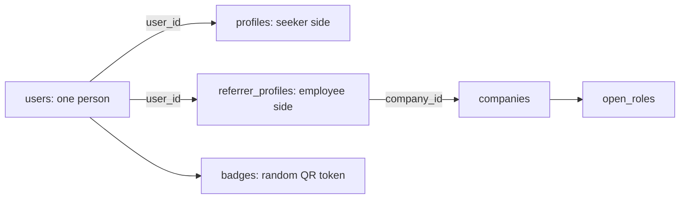

# Referral Portal POC

**Project:** Referral Portal for DevFest Pune  
**Event date:** 13 December 2026  
**Document date:** 24 October 2026  
**Purpose:** Explain the proof of concept (POC), what a user can try, how its data is stored, and what still belongs to the larger product.

> **Status key**  
> **IN POC** = implemented in the current source and suitable to demonstrate, subject to the deployed commit.  
> **PARTIAL** = only part of the workflow is implemented.  
> **NOT IN POC** = planned for the full product, but not implemented in this POC.  
> **BRANCH ONLY** = code exists on a feature branch but is not necessarily in the live deployment.

The live Render service deploys a Git branch. A feature branch is not live just because it was pushed. Confirm the deployed commit in Render before promising a feature in a demo.

## 1. The idea

Referral Portal is a mobile-first app where job seekers request help from opted-in employees and track referral handoffs at their companies.

- A **seeker** creates a profile, browses eligible companies, saves companies, and requests help with a company and role.
- A **referrer** verifies a work email, opts in to referral requests, and may refer a candidate.
- A **referral request** is sent to opted-in employees at one company; multiple employees may accept.
- A **referral** is a tracked internal handoff. The portal does not submit a candidate to a company's hiring system.

The POC demonstrates part of this loop. It is not a job board, recruitment platform, or completed event-day system.

## 2. What can be demonstrated

| Capability | POC status | Notes |
|---|---|---|
| Google and GitHub sign-in | IN POC | OAuth creates a user the first time; later sign-ins reuse the account by email. |
| Seeker profile | IN POC | Experience, skills, roles wanted, pitch, profile links, and optional phone. Resume upload is not included. |
| Work-email verification | IN POC | Six-digit emailed code; unlocks referrer settings. It is not required to sign in or save a seeker profile. |
| Company directory | IN POC | Companies with at least one verified employee opted in to referral requests; employee identities are not listed. |
| Wishlist | IN POC | A seeker can save up to five companies. |
| Company referral requests | IN POC | A seeker requests one company/role; every opted-in employee is invited, and several can accept. |
| Referral submission tracking | IN POC | Referrers mark internal submission; seekers confirm. The app does not submit to the employer's system. |
| Referral request credits | IN POC | Five base requests per rolling 30 days; capped earned credits can raise the allowance. |
| Referral reminders | IN POC | Accepted referrers receive up to three email reminders at two-day intervals. |
| Light/dark theme | IN POC | Theme choice persists in the current browser. |
| Legacy meeting/chat APIs | RETAINED, HIDDEN IN UI | Tables, endpoints, and old data remain for possible future use; the frontend no longer starts meetings or chats. |
| QR badge | IN POC | Contains a random token, not the user's database ID. |
| Resume upload | NOT IN POC | Reserved for future work; seekers share existing profile fields and provide a job link with each request. |
| Account deletion | IN POC | Deletes a user's account and associated data after an explicit confirmation. It is permanent. |
| Profile save without work email | IN POC | Work-email verification is optional for seeker features and only required to become a referrer. |
| Database Explorer learning page | IN POC | `frontend/public/database-explorer.html` is tracked and served as a static page. |

## 3. What's not in this POC

These are features for the larger product, not things a tester should assume are available:

- Camera-based QR scanning, scan history, and offline scan synchronization.
- Candidate search/cards and the referrer's Save, Pass, and Refer actions.
- Referrals-made dashboard, status updates, and copying a referral packet.
- Resume upload and private download.
- Enforcement of the hide-from-my-company privacy option in search and scans.
- Creating reports or blocks in the user interface. Existing block records are checked in conversation rules.
- A separate notification center. Referral requests appear in the Referrals inbox, and invite/reminder emails use the configured mail provider.
- Automated message-retention/purge job.
- Admin console, sponsor dashboard, live event statistics, and bulk badge export.
- PWA installation/offline support, full 1,000-person load testing, and end-to-end phone testing for all 14 planned screens.
- Meeting-request credits. The legacy ledger remains unused; company referral requests use their own expiring credit records.

## 4. How the application is organized

This is one Git repository with two applications:

| Part | Technology | Responsibility |
|---|---|---|
| Frontend | React, TypeScript, Vite | Screens and browser interactions. During development it runs on port 5173. |
| Backend | Java 21, Spring Boot, Maven | OAuth, API endpoints, authorization, business rules, email, and database access. During development it runs on port 8080. |
| Database | MySQL 8 | Stores accounts, profiles, companies, requests, chats, and other records. |
| Schema changes | Flyway SQL migrations | Creates and updates tables when the backend starts. |
| Shared development database | Aiven MySQL | Shared development data; connection details are supplied privately and kept in the ignored root `.env`. |
| Isolated local database | Docker Compose | Optional MySQL on port 3307, separate from Aiven and persisted in a local Docker volume. |
| Production database | Separate database server | Production will use a different database server from shared development Aiven. |
| Hosted app | Render Docker Web Service | Builds and runs the combined React + Spring Boot image. |

The backend uses an explicit **controller → service → repository** layout, with dedicated `dto` and `entity` packages alongside it:

1. **Controller** (`controller/`) receives an HTTP request and returns a response.
2. **Service** (`service/`) applies the product rules, such as request limits or OTP expiry.
3. **Repository** (`repository/`) runs SQL against MySQL.
4. **DTO** (`dto/`) — Java records used to carry data to and from API requests, all consolidated in one package.
5. **Entity** (`entity/`) — JPA `@Entity` classes (one per table) that document the schema and its foreign-key relationships with annotations such as `@OneToOne`, `@ManyToOne`, `@OneToMany`, and `@JoinColumn`.

Flyway SQL migrations manage the schema, and repository data access uses Spring Data JPA repositories backed by JPA entities. Hibernate does not generate schema changes (`ddl-auto: none`). The configured database is selected through environment variables; demo data is not seeded by the application.

## 5. The people and account model

The `users` table is the identity anchor: one row per person. A person can be both a seeker and a referrer without creating a second account.

- `users` stores the sign-in identity, name, email, provider, consent time, and creation time.
- `profiles` stores the seeker's experience, skills, pitch, links, and optional phone. Its `user_id` points to `users.id`.
- `referrer_profiles` stores the employee side: verified work email, company, job title, referral-request opt-in, role preferences, and active-assignment limit. Verification alone does not opt someone in.
- `badges` stores one random QR token per user.

Sign-in email and work email are different concepts. The login email belongs to `users`; the verified company email belongs to `referrer_profiles` after OTP confirmation.

## 6. Main user flows and their tables

### A. Sign in

1. The user chooses Google or GitHub.
2. The backend looks for their normalized email in `users`.
3. If it is new, the backend inserts `users` and a corresponding `badges` row in one transaction.
4. If the email already exists, the app reuses that account.
5. The app checks whether a `profiles` row exists and routes the user to Profile or Companies.

**Tables:** `users`, `badges`, then `profiles` when checking onboarding. New accounts do not receive seeded conversations or referrals.

### B. Create a seeker profile

The user can save their profile without a work email. The backend inserts or updates their row in `profiles`, keyed by `user_id`. Profile data includes an optional phone number; contact details are shared only according to the choices made for an accepted referral request.

**Table:** `profiles`. Skills and roles wanted are JSON lists. Work-email verification is a separate optional step to unlock referrer settings.

### C. Verify a work email

1. The user enters a company email address.
2. The app rejects common free-email domains, addresses already claimed by another account, and excessive resend attempts.
3. The backend creates a random six-digit code and stores only its BCrypt hash in `email_otps`.
4. Brevo sends the code. It expires after 10 minutes; incorrect attempts are counted and locked after five.
5. On correct confirmation, the backend finds or creates a `companies` row from the email domain and creates/updates `referrer_profiles`.

**Tables:** `users`, `email_otps`, `companies`, `referrer_profiles`. The company name is derived from the domain; organizers can rename/manage company details later.

### D. Browse and save companies

The company directory returns companies that have at least one verified employee who opted in to referral requests. Employee names are not listed. A seeker saving a company creates a row in `wishlists`.

The wishlist's composite key (`seeker_id`, `company_id`) prevents duplicate saves. The five-company maximum is enforced by application code.

**Tables:** `companies`, `referrer_profiles`, `users`, `wishlists`.

### E. Request a company referral

1. Any seeker with a profile selects a company and free-form role title and provides an HTTPS job URL; a note is optional. Work-email verification is not required to seek a referral.
2. The seeker explicitly consents to sharing a profile summary. Their sign-in email is shared only with employees who accept; sharing an optional phone remains a separate choice.
3. The backend validates the company, excludes the seeker's own verified company, enforces duplicate-request and rolling allowance rules, then creates one `company_referral_requests` row and one pending `referral_request_responses` row for every opted-in employee.
4. Invitees receive an in-app inbox item and a work-email notification. Role preferences do not filter invitations. Multiple employees may accept; each acceptance independently uses active-assignment capacity and collects its contact-sharing choices.
5. An accepted referrer uses the employer's internal process and marks the referral submitted. The app creates a `referrals` row but does not submit anything into the employer's internal portal.
6. The seeker confirms that submission. The referrer may earn one bonus request credit, capped at two credits per rolling 30 days; credits expire after 90 days.
7. Requests with no acceptance expire after four days and refund the request allowance. Accepted assignments receive up to three reminders at two-day intervals and close after day 10 if still unsubmitted.

**Tables:** `company_referral_requests`, `referral_request_responses`, `referral_request_credits`, `referrals`, `notifications`, `profiles`, `referrer_profiles`, `companies`, and `users`.

### F. Legacy meetings and chat

The previous `conversations` and `messages` APIs, data model, and old records are retained, but the frontend no longer exposes the meeting/chat flow. They can be re-integrated later without deleting historical data.

**Tables:** `conversations`, `messages`. `reviews` remains reserved for private Save/Pass notes.

### G. Delete an account

The user confirms by typing `DELETE`. Deletion is permanent and runs in a transaction. The repository first deletes conversations, reviews, and referrals because their foreign keys do not cascade. It then deletes the `users` row; configured cascade rules remove the user's profile, badge, work-email OTPs, wishlist rows, scans, and other owned data. The company row is not deleted because it may be shared by other employees.

## 7. Database table guide

The schema has **20 tables**, grouped by what they represent:

| Table | Plain-language purpose | POC status |
|---|---|---|
| `users` | Sign-in identity; one row per person | IN POC |
| `profiles` | Seeker profile | IN POC |
| `referrer_profiles` | Verified employee/referrer settings | IN POC |
| `companies` | Company directory | IN POC |
| `open_roles` | Company roles shown in the directory | IN POC; mainly seeded |
| `email_otps` | Hashed, expiring work-email verification codes | IN POC |
| `badges` | Random QR token for each person | IN POC |
| `wishlists` | Seeker-to-company saved-interest links | IN POC |
| `company_referral_requests` | One seeker request for a company and role | IN POC |
| `referral_request_responses` | Each invited employee's response and submission lifecycle | IN POC |
| `referral_request_credits` | Earned, consumed, and expiring request credits | IN POC |
| `conversations` | Legacy meeting request and chat lifecycle/counter | Retained; UI hidden |
| `messages` | Legacy chat text | Retained; UI hidden |
| `referrals` | Referral submission and status history | IN POC |
| `reviews` | Referrer Save/Pass and private notes | NOT IN POC |
| `scans` | QR scan history | NOT IN POC |
| `reports_blocks` | Report/block records | PARTIAL; existing blocks are checked |
| `credit_ledger` | Request credits | PARTIAL; currently contributes zero |
| `notifications` | Referral invitation and status notifications | IN POC |
| `resume_files` | Private resume file data | NOT IN POC |

## 8. Initial data and test status

- The application does not automatically seed demo companies, users, roles, conversations, or referrals. A company is created when an employee verifies a work email; no sample referrers are added.
- The shared Aiven database may still contain existing records until they are deliberately removed; removing the seeder does not delete existing database rows.
- Backend tests cover startup, work-email verification, account deletion, referral requests, contact consent, expiry/refunds, reminders, and API route compatibility. The frontend has lint/build checks.
- CI checks the backend and frontend builds when changes are pushed to GitHub.
- A passing test/build is not a substitute for testing sign-in and email delivery on the actual hosted service.

## 9. Important POC limits and risks

- The app tracks that an employee submitted a referral but cannot submit a candidate into an employer's internal hiring system.
- Resume upload, reports, message retention, camera scanning, and admin tools are not implemented.
- The browser theme preference is not synchronized between devices or accounts.
- Account deletion is permanent; test it with a disposable account, not a primary account.
- Email codes depend on working Brevo SMTP settings and deliverability.
- Render free services can sleep when idle; the shared Aiven development database may have its own availability limits. This setup is not a production reliability guarantee.
- Before a public event launch, confirm which commit is deployed and test the full flow on a phone.

## 10. One-minute explanation

> One person signs in and gets a row in `users` plus a random QR badge. Their seeker profile works without company-email verification. A verified employee separately opts in to help with referrals. A seeker request creates one company/role record and individual responses for opted-in employees. Accepted employees can share selected contacts, mark an internal referral submitted, and receive reminders; the seeker confirms submission before the referrer earns a capped request credit. The portal tracks the handoff but does not submit to the company's internal hiring system.

---

**Sharing note:** This overview explains the POC source and its limits; check the Render deployment commit before presenting branch-only changes as live.